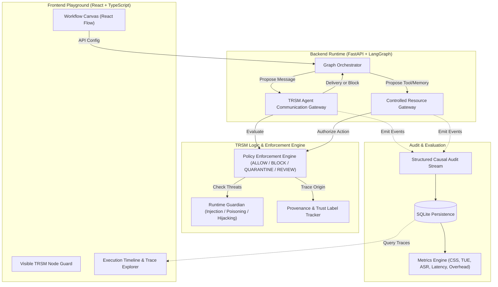

# TRSM Middleware: Trust, Risk, and Security Management for Multi-Agent Systems

[](https://opensource.org/licenses/MIT)
[](https://www.python.org/)
[](https://nodejs.org/)

TRSM is a lightweight, provenance-aware middleware layer designed to enforce trust, risk, and security policies in LLM-based Agentic Multi-Agent Systems (AMAS). It wraps execution runtimes (such as LangGraph) to provide mandatory mediation for inter-agent communication, independent authorization for tools and memory, causal audit tracing, and rigorous security/utility evaluation.

---

## 1. High-Level Architecture



### Core Invariants

- **Mandatory Message Mediation:** Every inter-agent message is intercepted and mediated by the backend `Agent Communication Gateway`.
- **Independent Resource Authorization:** Tool, database, and memory access must independently pass through the `Controlled Resource Gateway`.
- **Authoritative Decisions:** Security outcomes (`ALLOW`, `BLOCK`, `QUARANTINE`, `REVIEW`) are strictly decided by the backend Policy Engine. The frontend is a visualization and configuration interface, not a security boundary.
- **Causal Tracing:** Every message proposal, decision, and tool action maintains immutable provenance and causal links (`run_id`, `trace_id`, `event_id`, `parent_event_id`).

---

## 2. Project Status & Roadmap

- **Status:** Initial Scaffold & Specification Complete (Pre-MVP Phase).
- **Milestone 1:** Canonical Pydantic contracts and deterministic vertical slice (In Progress).
- **Milestone 2:** Visual React Flow canvas, node guard badges, and live trace explorer.
- **Milestone 3:** Provenance propagation and threat detectors (Prompt Injection, Memory Poisoning, Role Hijacking).
- **Milestone 4:** CSS/TUE metric calculation and baseline vs. protected evaluation harness.

---

## 3. Repository Layout

```text
TRSM-middleware/
├── README.md                           # This file
├── AGENTS.md                           # AI agent operational brief
├── STRUCTURE.md                        # Monorepo architecture & conventions
├── TRSM_MASTER_PROJECT_SPEC.md         # Master project specification
│
├── docs/                               # Architectural & research documentation
│   ├── architecture/                   # Architectural overviews & gateway mechanics
│   ├── decisions/                      # Architecture Decision Records (ADRs)
│   ├── design/                         # System, module, and API designs
│   ├── research/                       # Literature surveys & research gaps
│   ├── evaluation/                     # Metric formulas & evaluation protocols
│   └── team/                           # Workplans for Tejasvi, Debarshi, & Yashwanth
│
├── backend/                            # Python / FastAPI / LangGraph service
│   ├── app/
│   │   ├── api/                        # HTTP routes & dependencies
│   │   ├── schemas/                    # Canonical Pydantic models (single source of truth)
│   │   ├── runtime/                    # Orchestrator, gateways, and adapters (Yashwanth)
│   │   ├── trsm/                       # Policy engine, guardian, provenance (Tejasvi)
│   │   ├── audit/                      # Structured event collector & trace builder
│   │   ├── persistence/                # SQLite storage & repositories
│   │   └── evaluation/                 # CSS/TUE, security metrics, and experiment runner
│   └── tests/                          # Unit, integration, and API tests
│
├── frontend/                           # React + TypeScript + Vite playground
│   └── src/
│       ├── components/                 # Canvas, AgentNode, NodeGuard, TraceExplorer
│       ├── pages/                      # Playground, RunDetails, Evaluation
│       ├── api/                        # Typed backend API client
│       └── types/                      # Wire types synced with Pydantic schemas
│
├── scenarios/                          # Versioned test scenarios (YAML)
│   ├── benign/                         # Baseline legitimate operations
│   ├── prompt_injection/               # Instruction override & propagation
│   ├── memory_poisoning/               # Untrusted memory write attempts
│   ├── role_hijacking/                 # Unauthorized role/capability escalation
│   └── resource_authorization/         # Unauthorized tool/db operations
│
├── scripts/                            # Development, testing, and type sync scripts
└── artifacts/                          # Sanitized experiment results & trace exports
```

---

## 4. Prerequisites

- **Python**: Version 3.12 or higher.
- **Node.js**: Version 20.x or higher with `npm`.
- **Local LLM (Optional)**: [Ollama](https://ollama.ai) for local inference (e.g., `llama3:8b`). Unit tests and deterministic slices run without Ollama using mock adapters.

---

## 5. Quickstart & Local Setup

### Backend Setup

```bash
# Navigate to backend directory
cd backend

# Create and activate virtual environment
python -m venv .venv

# Windows (PowerShell)
.\.venv\Scripts\Activate.ps1
# Linux / macOS
# source .venv/bin/activate

# Install dependencies
pip install -r requirements.txt

# Run backend API server
uvicorn app.main:app --reload --host 127.0.0.1 --port 8000
```
Backend API will be accessible at `http://127.0.0.1:8000` with Swagger docs at `http://127.0.0.1:8000/docs`.

### Frontend Setup

```bash
# Navigate to frontend directory
cd frontend

# Install npm dependencies
npm install

# Start Vite development server
npm run dev
```
Frontend visual playground will be running at `http://localhost:5173`.

---

## 6. Running Tests & Deterministic Demo

```bash
# Run backend test suite
cd backend
pytest -v

# Run the deterministic vertical slice scenario
python ../scripts/run_demo.py --scenario scenarios/benign/backend_to_db_allowed.yaml
```

---

## 7. Security & Evaluation Note

> [!WARNING]
> TRSM is a research prototype. Never connect real credentials, unrestricted shell adapters, or production databases to the playground or demo agents. Use the provided mock tools and sandboxed SQLite environments.

For in-depth architectural and research details, consult:
- [TRSM Master Project Specification](TRSM_MASTER_PROJECT_SPEC.md)
- [Repository Structure Blueprint](STRUCTURE.md)
- [Operational AI Agent Guidelines](AGENTS.md)
