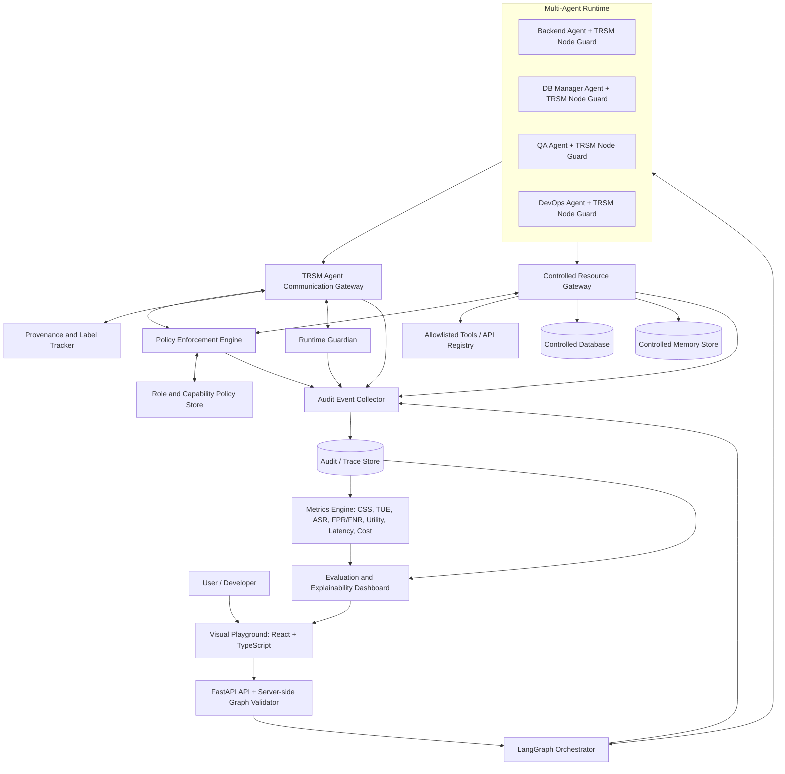
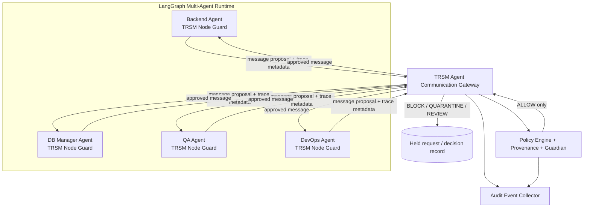
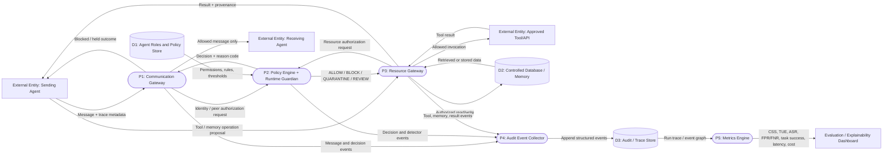
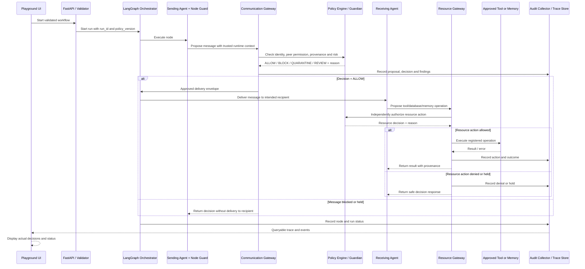
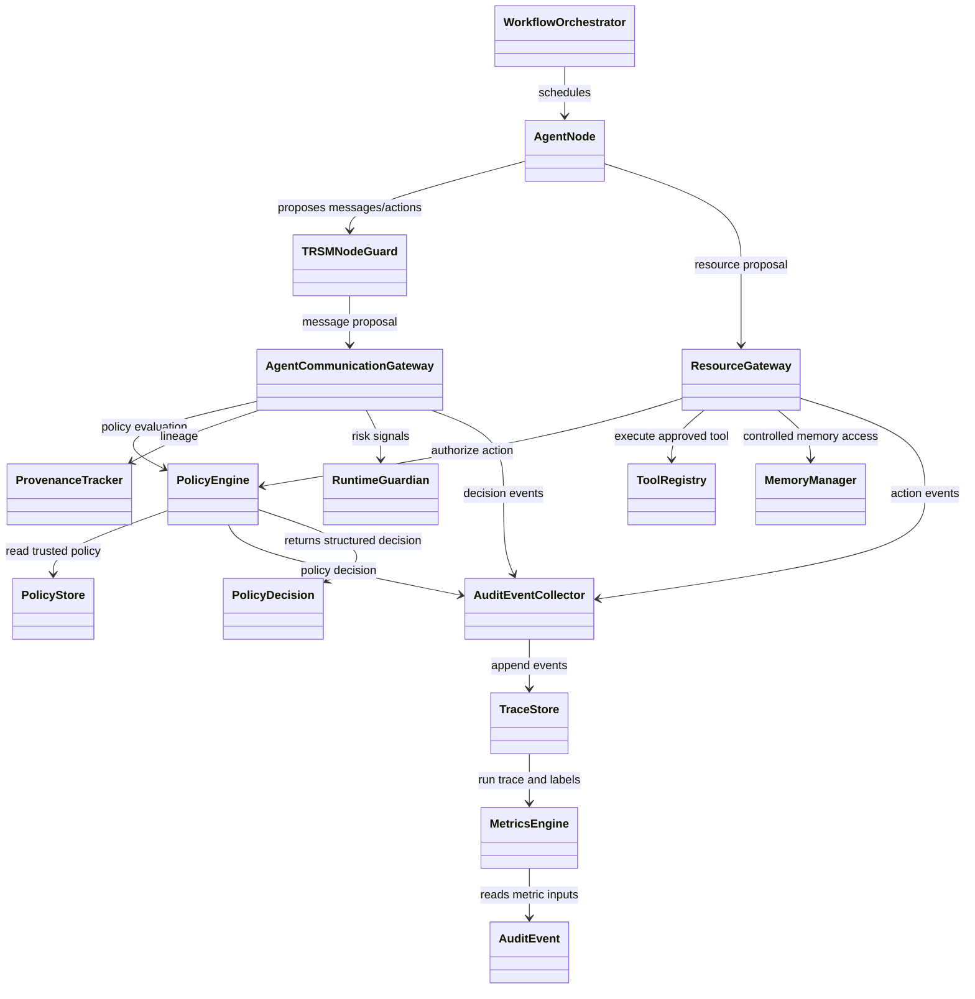

# TRSM Master Project Specification

**Project title:** TRSM Middleware for Trust, Risk, and Security Management in LLM-Based Agentic Multi-Agent Systems  
**Document type:** Master project context, architecture specification, implementation guide, evaluation plan, and AI-agent operating brief  
**Status:** Pre-development / implementation planning  
**Primary purpose:** Single source of truth for the development team, research team, and any AI coding/research agent contributing to the project.  
**Last consolidated:** 23 October 2026

> **Status and evidence convention**
>
> - **Agreed direction** means the team has chosen this design direction in discussion.
> - **Proposed implementation** means a concrete recommendation that should be used unless the team records a decision to change it.
> - **Not yet validated** means no implementation result or experiment is being claimed.
> - Metrics, performance figures, attack reductions, and test outcomes must never be invented. Record them only after executing the corresponding experiment.

## Contents

- [0. How an AI agent should use this document](#0-how-an-ai-agent-should-use-this-document)
- [1. Executive overview](#1-executive-overview)
- [2. Project motivation and research position](#2-project-motivation-and-research-position)
- [3. Users and primary demonstration](#3-users-and-primary-demonstration)
- [4. Architectural principles and invariants](#4-architectural-principles-and-non-negotiable-invariants)
- [5. Overall architecture](#5-overall-architecture)
- [6. TRSM security model](#6-trsm-security-model)
- [7. Communication and resource mediation contracts](#7-communication-and-resource-mediation-contracts)
- [8. Provenance and memory model](#8-provenance-and-memory-model)
- [9. Audit and instrumentation specification](#9-audit-and-instrumentation-specification)
- [10. Metrics and evaluation methodology](#10-metrics-and-evaluation-methodology)
- [11. Functional requirements](#11-functional-requirements)
- [12. Non-functional requirements and constraints](#12-non-functional-requirements-and-constraints)
- [13. Frontend/playground specification](#13-frontendplayground-specification)
- [14. API, data contracts, and persistence](#14-api-data-contracts-and-persistence)
- [15. Team ownership and collaboration](#15-team-ownership-and-collaboration)
- [16. Agentic development workflow](#16-agentic-development-workflow)
- [17. Development milestones and acceptance criteria](#17-development-milestones-and-acceptance-criteria)
- [18. Definition of done](#18-definition-of-done)
- [19. Assumptions, risks, and unresolved decisions](#19-known-assumptions-risks-and-unresolved-decisions)
- [20. Research literature](#20-research-literature-and-how-each-source-is-used)
- [21. Project artifacts](#21-project-artifacts-and-relationships)
- [22. Proposed repository layout](#22-proposed-repository-layout)
- [23. First end-to-end implementation](#23-recommended-first-end-to-end-implementation)
- [24. Final project definition](#24-final-project-definition)

---

## 0. How an AI agent should use this document

Read this document before planning, editing code, generating diagrams, changing an API, writing the research paper, or proposing architectural modifications. It contains the project's current intent and must be treated as the primary project context.

### Instructions to AI coding agents

1. **Inspect the repository before changing it.** Do not assume the suggested directory layout already exists. Keep working code and established conventions where possible.
2. **Preserve the core security invariant:** every inter-agent message is mediated by the backend's central TRSM Agent Communication Gateway. Tool, database, and memory operations must pass through a separate controlled Resource Gateway. Do not introduce direct paths around these gateways.
3. **Do not treat the frontend as a security boundary.** The browser can request actions and display decisions; it cannot authorize messages or resources.
4. **Do not let an agent modify its own trusted identity, role, tool permissions, peer permissions, policies, or orchestrator state through model-generated content.** Those settings are controlled by trusted application configuration.
5. **Separate mechanism from detector.** A detector can generate evidence or a threat finding; the trusted Policy Enforcement Engine makes the allow/block/quarantine/review decision. An LLM classifier must not independently grant permission.
6. **Use typed contracts.** Coordinate schema changes with the owners of the backend, TRSM logic, and frontend. Do not independently invent a second message or event schema.
7. **Audit decisions and outcomes as structured events.** Do not derive research metrics by scraping human-readable logs.
8. **Fail closed for unknown or malformed security-sensitive requests.** If an identity, tool, resource, permission, or policy context required for authorization is unknown or invalid, do not silently allow the operation.
9. **Do not overstate trust labels.** A label records provenance or validation state; it does not prove that the content is safe. Agent-generated summaries must not automatically turn untrusted content into trusted instructions.
10. **Do not invent CSS/TUE formulas.** Reproduce the definitions in the selected TRiSM reference paper where they can be operationalized; document any adaptation as an adaptation and keep component measurements visible.
11. **Test both positive and negative behaviour.** For every enforcement feature, test allowed cases, denied cases, malformed requests, benign cases that resemble attacks, and bypass attempts.
12. **Do not claim tests or experiments passed unless they were actually run.** Report the command, result, limitations, and any untested areas.
13. **Keep changes scoped.** For agentic coding, ask for a plan, restrict the files/modules, inspect diffs, run tests, and avoid unrelated refactors.
14. **Never present the planned architecture as already implemented.** This document is a plan; implementation status must be updated as work is completed.
15. **When a requirement conflicts with this document, stop and surface the conflict.** Propose a change with a reason rather than silently changing the architecture.

### Instructions to AI research/writing agents

- Use the references in Section 15 as starting points, then verify claims against original papers and official repositories.
- Distinguish source findings, team design decisions, hypotheses, and measured project results.
- Do not claim that PEP, provenance labels, hash-chained logs, security gateways, CSS, or TUE are original inventions of this project.
- The intended contribution is an implemented and empirically evaluated multi-agent integration: per-agent guard instrumentation, mandatory central inter-agent mediation, controlled tool/memory access, workflow-level provenance/audit, and evaluation of security, coordination, utility, and overhead.
- Preserve limitations and unsuccessful trials in the final report.

---

## 1. Executive overview

TRSM is a lightweight middleware layer for LLM-based Agentic Multi-Agent Systems (AMAS). It is intended to sit around an existing multi-agent execution runtime rather than replace the agents or the underlying language models.

The application will be demonstrated through a visual, n8n-like workflow playground. A user creates a graph, configures agent roles/models/instructions/permissions, connects agents, and starts a run. The initial demonstration domain is a software-engineering workflow with agents such as **Backend Agent**, **DB Manager Agent**, **QA Agent**, and **DevOps Agent**.

The distinguishing architectural idea is that **TRSM is visible on every agent node, while enforcement is implemented in the trusted backend**:

- Every agent node displays a **TRSM Node Guard**. It tags and routes outbound messages and proposed resource operations; it is not itself the ultimate authorization authority.
- All inter-agent messages pass through the central **TRSM Agent Communication Gateway**. The gateway checks sender/receiver identity, allowed peer relationships, provenance, threat signals, and policy before a message reaches its recipient.
- Tool, database, and memory operations pass through a separate **Controlled Resource Gateway** and are authorized independently of the preceding agent message.
- A shared **Policy Enforcement Engine** returns a structured decision: `ALLOW`, `BLOCK`, `QUARANTINE`, or `REVIEW`.
- A **Runtime Guardian** detects a limited initial set of threats: prompt-injection propagation, memory poisoning, and role/orchestrator hijacking.
- A shared **Audit Event Collector and Trace Store** connect messages, decisions, tool/memory operations, and results into a causal trace.
- A **Metrics Engine** evaluates Component Synergy Score (CSS), Tool Utilization Efficacy (TUE), attack success rate, false positives/negatives, task success, latency, and cost.
- The visual playground shows the actual workflow configuration, runtime node status, gateway decisions, audit traces, and evaluation results.

The project is not intended to secure every possible attack or to certify a production system. It is a controlled research prototype designed to answer this question:

> Can a lightweight, provenance-aware TRSM layer improve security and auditability in a small LLM multi-agent workflow while preserving legitimate task completion, agent coordination, tool-use quality, and acceptable runtime overhead?

The answer must be established by experiments, not assumed in advance.

## 2. Project motivation and research position

### 2.1 Problem being addressed

A multi-agent LLM application can fail at several connected boundaries:

- a user or retrieved document contains a prompt injection;
- an agent forwards that instruction to another agent;
- the receiving agent treats it as trusted context;
- a later agent calls a tool or writes persistent memory;
- the final action causes an unauthorized operation or corrupts later runs;
- without good tracing, the developer cannot reconstruct where the failure originated.

A prompt telling agents to “be secure” is not an enforcement mechanism. A system also needs reliable runtime control over message delivery and resource access, with enough event data to explain and evaluate decisions.

### 2.2 Research framing

The project is aligned with Trust, Risk, and Security Management for agentic AI (often written **TRiSM** in the literature; this project uses **TRSM** in its name). The literature already covers multiple pieces of the problem: policy enforcement, prompt-injection benchmarks, memory-poisoning attacks, tool-use evaluation, runtime telemetry, and audit logging.

We must not claim that the individual ideas are new. The intended project contribution is the **integration and empirical evaluation** of:

1. visible per-agent Node Guards with mandatory backend mediation;
2. a central policy-controlled communication path between agents;
3. separate authorization for tool, database, and memory operations;
4. provenance-aware traces across agent-to-agent propagation and resource access;
5. CSS/TUE and security/utility/overhead measurements on a real multi-agent testbed.

### 2.3 Scope boundary

**In scope for the first prototype**

- one visual workflow playground;
- one execution backend and one orchestration framework (LangGraph is the selected starting point);
- 3–5 agents;
- a small, allowlisted set of tools and controlled memory/database operations;
- deterministic authorization rules;
- the three selected attack families;
- structured audit traces and initial metric calculations;
- a baseline-versus-protected experiment runner;
- a dashboard for inspecting runs, traces, security decisions, and measurements.

**Out of scope unless explicitly added later**

- securing all agent frameworks or all types of tool servers;
- arbitrary untrusted shell execution or unrestricted filesystem access;
- a production multi-tenant cloud deployment;
- a general-purpose enterprise governance platform;
- protection against all unknown/adaptive attacks;
- proving semantic safety for every generated message;
- claiming universal performance or security guarantees;
- developing or training a large foundation model;
- building multiple polished framework adapters before the first end-to-end demo works.

---

## 3. Users and primary demonstration

### 3.1 Intended user

The primary user is a developer/researcher who wants to construct a multi-agent workflow, configure each node, run it, observe the middleware decisions, and compare protected execution with a baseline.

### 3.2 Demonstration workflow

The first graph can contain these sample agents:

| Agent | Primary responsibility | Example allowed capabilities (must be configured, not assumed) |
|---|---|---|
| Backend Agent | Code and application logic | Read selected repository files, propose code changes, request tests |
| DB Manager Agent | Database operations and schema/data queries | Access a mock or test database with read/write scopes defined separately |
| QA Agent | Test generation, execution results, and review | Run approved tests, inspect structured results, return findings |
| DevOps Agent | Build/deployment configuration and release checks | Read build metadata, run approved validation tasks; deployment actions should require stronger controls or stay mocked |

Four agents are a useful demonstration, but the system must support 3–5 rather than hard-code four agents as a requirement. The workflow is a software-engineering scenario because it naturally exposes messages, tools, permissions, memory, testing, and potential privilege differences.

### 3.3 Example scenario

The Backend Agent retrieves a document that contains an instruction to reveal an environment variable and forwards text derived from it to the DB Manager Agent. TRSM should retain the external origin, inspect the proposed inter-agent message, and apply policy. If the DB Manager later proposes an unauthorized resource access, the Resource Gateway must independently deny it, even if the earlier message was allowed. The trace should connect the source document, propagation hops, policy decisions, attempted operation, and final outcome.

The expected system behaviour is to **preserve legitimate task functionality while preventing unauthorized actions**, not to block every message that mentions an attack.

---

## 4. Architectural principles and non-negotiable invariants

1. **Every inter-agent message is mediated.** No receiver may consume a message through a direct side channel or unvalidated shared state.
2. **Every tool/database/memory operation is mediated separately.** Message permission does not imply action permission.
3. **Backend policy is authoritative.** UI state, a prompt, an agent's assertion, or a detector output cannot grant a capability.
4. **Orchestrator identity is trusted runtime context.** Do not authenticate a sender solely using a sender field in model-generated JSON.
5. **Default-deny for unknown sensitive operations.** Unknown agent, peer, tool, resource, unsupported operation, missing policy context, or malformed security-sensitive request must not silently pass.
6. **Detection and authorization are separate.** Threat detection provides signals; the policy engine makes the final control decision using permissions and context.
7. **Provenance persists across hops.** Forwarded, quoted, summarized, and memory-stored content should retain source event/lineage metadata where applicable.
8. **A trust label is not a safety guarantee.** `tool_result`, `agent_generated`, or `validated` means something specific about origin or checks; it does not mean that the content cannot contain malicious instructions.
9. **Audit records use structured events.** Metric calculations operate on typed records, not console strings.
10. **Evaluation balances security and utility.** Reduced ASR alone is insufficient if the middleware destroys legitimate task success.
11. **The visual “TRSM Node Guard” is a UI representation plus a runtime integration hook.** The actual protection exists in backend-controlled routes and gateways.
12. **Keep it lightweight.** Start in-process/local wherever practical; add service separation only when a measured requirement justifies it.

---

## 5. Overall architecture

### 5.1 Logical architecture



**Architecture note:** the TRSM Node Guard may be visually placed inside every agent node and used as the outbound interceptor, but it is not a separate independent authority. The central gateway and backend Policy Enforcement Engine remain authoritative. Every message proposal reaches the gateway before the orchestrator makes it available to a recipient.

### 5.2 Three cooperating planes

| Plane | Purpose | Main elements |
|---|---|---|
| Data / execution plane | Runs agents and intercepts operations | LangGraph orchestrator, agents, Node Guards, communication gateway, resource gateway, tool registry |
| Control plane | Defines who may do what | Workflow graph, role/peer permissions, policy rules, tool allowlists, risk thresholds, rate limits, policy versions |
| Observability / evaluation plane | Explains and measures the run | Event collector, trace store, provenance links, threat findings, CSS/TUE, security and overhead metrics, dashboard |

For an initial local prototype these may run within one backend process while remaining separate modules. Logical separation is more important than deploying each component as an independent service.

### 5.3 Component responsibilities

| Component | Responsibility | Must not do |
|---|---|---|
| Visual Playground | Create/configure workflow graph; start a run; display status and real backend decisions | Authorize operations or fabricate successful decisions |
| API / Graph Validator | Validate workflow JSON, nodes, connections, agent configs, tool references, required fields and limits | Trust client-side validation alone |
| LangGraph Orchestrator | Own run state, scheduling, node transitions, and approved delivery | Deliver messages directly around the gateway |
| TRSM Node Guard | Intercept/tag outbound message, tool request and memory request; attach runtime metadata | Be the only enforcement check or use model-controlled identity as authority |
| Agent Communication Gateway | Enforce mediation for every agent message; check sender/recipient, graph relationship, provenance, threat signals, and policy | Deliver blocked/quarantined/review-held content to recipient as normal input |
| Policy Enforcement Engine | Apply deterministic permission/risk rules; return structured outcome and reason | Execute arbitrary tools or rewrite trusted policies |
| Role & Capability Policy Manager | Store identities, role permissions, peer allowlists, tool scopes, thresholds, rate limits, policy version | Accept permission changes from model-generated content |
| Provenance & Label Tracker | Record source types and lineage across messages/results/memory | Treat labels as a proof of semantic safety |
| Runtime Guardian | Detect initial threat families and emit structured findings | Directly grant permissions or execute resources |
| Controlled Resource Gateway | Validate and authorize tool, database, and memory operations before execution | Expose unmanaged direct access from agent code |
| Tool Registry | Map approved tool names to constrained implementations and argument schemas | Allow arbitrary tools because an agent requested them |
| Memory Manager | Control memory reads/writes, metadata, provenance and storage rules | Store untrusted instructions as trusted policy |
| Audit Event Collector | Receive typed events from all instrumented components | Derive metric data from free-form log text |
| Trace Store | Persist events and lineage references; support trace query and optional integrity verification | Store secrets indiscriminately |
| Metrics / Evaluation Engine | Compute metrics from labelled events and trial outcomes | Invent values or silently change metric definitions |
| Evaluation Dashboard | Visualize actual traces, decisions and measured outcomes | Represent mock/sample values as real experimental results |

### 5.4 Main execution sequence

1. User edits workflow and submits a graph/task.
2. Backend validates the graph, node identifiers, configured peer connections, tools, schemas and policy references.
3. Orchestrator starts a run with a unique `run_id`, a workflow version, and a policy version.
4. An agent proposes an inter-agent message or resource operation through its Node Guard.
5. For an agent message, the Communication Gateway checks identity, peer authorization, lineage, content/risk signals, and policy.
6. The Policy Engine returns `ALLOW`, `BLOCK`, `QUARANTINE`, or `REVIEW`, with a reason code and relevant evidence.
7. Only `ALLOW` messages are delivered to the target agent. A quarantined or review-pending message is stored outside the recipient's trusted context.
8. Any subsequent tool/database/memory request is sent separately through the Resource Gateway and independently authorized.
9. Tool/memory results receive source and lineage metadata; the results return to the requester only through controlled runtime paths.
10. Each component emits events to the collector. Events are persisted and linked into a run trace.
11. After the run, the evaluation engine computes available metrics and the dashboard presents traces and results.

---

### 5.5 Per-agent communication flow (required enforcement view)

This view makes the core design decision explicit: each agent visibly contains a Node Guard, but **every message still travels through the central backend gateway before reaching another agent**.



The arrows from the gateway back to agents represent only gateway-approved delivery or a structured decision response. They do not mean each agent automatically receives all messages. The orchestrator delivers to the intended receiver only after the gateway returns an allowed decision.

### 5.6 Data Flow Diagram (DFD) — Level 1



DFD process definitions:

- **P1 Communication Gateway:** mediates agent-to-agent messages.
- **P2 Policy Engine + Runtime Guardian:** reads trusted rules, evaluates permissions, receives threat signals and produces a decision.
- **P3 Resource Gateway:** mediates tools, databases and memory operations independently of message authorization.
- **P4 Audit Event Collector:** receives structured events from runtime and enforcement components.
- **P5 Metrics Engine:** calculates metrics from recorded traces and evaluation labels.
- **D1:** trusted role, peer and policy configuration.
- **D2:** controlled data and memory resources.
- **D3:** audit and trace events.

### 5.7 Message flow sequence diagram



### 5.8 UML responsibility map

The implementation classes/packages should preserve the following dependency direction. Exact class names can change, but responsibilities should not be duplicated.



---

## 6. TRSM security model

### 6.1 Trust boundaries

**Trusted by design (within the prototype):**
- application-owned workflow/policy configuration after backend validation;
- the orchestrator's runtime identity and run context;
- the Policy Enforcement Engine and its permission store;
- gateway code and approved tool registry;
- audit metadata emitted by instrumented trusted components, subject to storage protections.

**Untrusted by default:**
- user-provided text;
- external documents/webpages;
- tool outputs unless validated for the intended use;
- model-generated messages and plans;
- any agent's claim that another agent granted permission;
- stored content without known provenance;
- frontend-supplied identities/permissions not confirmed by backend context.

### 6.2 Initial attack families

#### A. Prompt-injection propagation

Threat sequence: malicious or instruction-like external content enters an agent; the agent repeats or reframes it; another agent treats it as an instruction; the instruction influences a tool or memory action.

Controls: preserve origin labels and parent-event links; inspect messages at every hop; enforce peer/role/action permissions; deny unauthorized resource actions independently; record the origin and each decision.

Evaluation: define the attack objective per scenario (for example, unauthorized tool action), track whether it is reached, and record whether the malicious message was detected, blocked, or merely passed through.

#### B. Memory poisoning

Threat sequence: untrusted content is written into persistent or reusable memory; a later run retrieves it; an agent gives it authority it should not have; the poisoned content influences future behaviour.

Controls: intercept memory writes and reads; record writer/source/provenance/time; apply permitted memory namespaces and role-specific read/write rules; distinguish short-lived task state from persistent memory; do not allow a message to promote its own trust label.

Evaluation: create scenarios with clean and poisoned writes, test retrieval across later steps/runs as supported by the prototype, and measure whether the poison changes the defined downstream outcome.

#### C. Role/orchestrator hijacking

Threat sequence: a message tries to change an agent role, add a privileged peer, rewrite workflow control state, skip a node, or obtain unauthorized permissions.

Controls: role assignments and graph transitions are owned by the backend; model text cannot mutate policy; declared graph edges are not authorization on their own; only trusted configuration APIs can change trusted state; unexpected actions fail closed and are audited.

Evaluation: attempt unauthorized role/peer/policy changes and verify they do not affect actual runtime authority.

### 6.3 Initial policy rule families

Exact rule IDs and definitions must be finalized by Tejasvi and Yashwanth in the shared policy contract. The following is a useful initial catalogue; it should not be represented as copied verbatim from the PEP paper.

| Rule family | Input checked | Typical decision |
|---|---|---|
| Identity validity | Runtime-resolved sender identity, receiver existence, run membership | BLOCK unknown/mismatched identity |
| Peer authorization | Sender/receiver pair, graph configuration, policy version | BLOCK unauthorized peer relationship |
| Role/capability scope | Requested operation, sender role, configured permissions | BLOCK unsupported operation |
| Tool/resource allowlist | Tool/resource name, operation, argument schema, resource scope | BLOCK unknown tool or invalid/unauthorized arguments |
| Provenance/sensitivity | Source labels, lineage, destination, requested flow/action | ALLOW, BLOCK, QUARANTINE or REVIEW according to policy |
| Suspicious behaviour/rate limits | Rate, repeated failures, role changes, threat findings | BLOCK, QUARANTINE or REVIEW |
| Configuration immutability | Attempt to mutate role, permissions, policy, or orchestration state | BLOCK from model/agent context; trusted admin route only |
| Review requirements | High-risk or ambiguous action under configured policy | REVIEW if a review mechanism exists; otherwise fail closed |

### 6.4 Policy outcomes

- `ALLOW`: the operation passed required checks and may proceed to the next controlled step.
- `BLOCK`: reject the operation; it must not reach the receiver or resource.
- `QUARANTINE`: hold the content/action outside normal agent context for inspection; it must not be delivered as trusted input.
- `REVIEW`: pause the relevant operation pending a trusted human or explicit review resolver. If the MVP has no review-resolving path, the operation must remain held/denied rather than default to allow.

Every decision should be machine-readable and contain at least the decision, reason code, policy version, and the request/event identifiers. Include evidence references and detector findings when available.

### 6.5 Runtime Guardian design

Initial design should favour deterministic rules for structural violations and permissions. A lightweight classifier or LLM assessment may be introduced later as a supplementary signal for semantic ambiguity.

Expected finding fields:

```json
{
  "finding_id": "finding_...",
  "threat_type": "prompt_injection_propagation",
  "severity": "medium",
  "confidence": 0.0,
  "source_event_id": "evt_...",
  "evidence_summary": "Redacted evidence summary",
  "recommended_action": "QUARANTINE"
}
```

The example is schema guidance, not a real finding. Do not let detector confidence override hard permission rules. A high-risk operation remains disallowed when its capability check fails even if the detector reports low risk.

---

## 7. Communication and resource mediation contracts

### 7.1 Agent message envelope

Use a typed schema agreed between Yashwanth and Tejasvi. A conceptual minimum is:

```json
{
  "message_id": "msg_...",
  "run_id": "run_...",
  "trace_id": "trace_...",
  "parent_event_id": "evt_...",
  "sender_id": "backend_agent",
  "recipient_id": "db_manager_agent",
  "message_type": "task_request",
  "payload": {"summary": "Requested database lookup"},
  "source_type": "agent_generated",
  "provenance_refs": ["evt_..."],
  "created_at": "ISO-8601 timestamp",
  "workflow_version": "workflow-v1"
}
```

All values above are examples. In a real implementation, sender identity must be resolved from trusted orchestrator context rather than accepted uncritically from the payload. Raw payload may be stored by controlled reference or redacted summary, according to retention policy.

### 7.2 Policy decision envelope

```json
{
  "decision_id": "dec_...",
  "request_id": "msg_... or action_...",
  "decision": "ALLOW | BLOCK | QUARANTINE | REVIEW",
  "reason_code": "peer_not_authorized",
  "policy_version": "policy-v1",
  "finding_refs": [],
  "evidence_summary": "Minimal safe explanation",
  "decided_at": "ISO-8601 timestamp"
}
```

The reason code must be stable enough for tests and dashboard filtering. Human-readable explanation can change without changing the machine-readable category.

### 7.3 Message mediation algorithm

```text
function mediate_agent_message(proposal, trusted_runtime_context):
    request = normalize_and_validate(proposal)
    request.sender_id = trusted_runtime_context.authenticated_agent_id
    request.run_id = trusted_runtime_context.run_id
    request.trace_id = assign_or_preserve_trace_id(request)
    request.parent_event_id = trusted_runtime_context.parent_event_id

    if request is malformed:
        decision = BLOCK("invalid_message_schema")
        emit proposal/decision audit events
        return decision

    if sender/receiver is unknown or sender is not active in this run:
        decision = BLOCK("unknown_or_inactive_agent")
        emit audit events
        return decision

    if peer relation or role permission is not authorized:
        decision = BLOCK("peer_not_authorized")
        emit audit events
        return decision

    attach_or_preserve_provenance(request)
    findings = runtime_guardian.inspect(request, recent_trace)
    decision = policy_engine.evaluate_message(request, trusted_policy, findings)
    emit request, findings, decision, and outcome events

    if decision == ALLOW:
        orchestrator.deliver_to_recipient(request)
    elif decision == BLOCK:
        reject_without_delivery(request)
    elif decision == QUARANTINE:
        hold_outside_recipient_context(request)
    elif decision == REVIEW:
        hold_and_request_review(request)

    return decision
```

If a review resolver is not implemented, `REVIEW` remains held and may time out to a safe deny. No timeout may convert it to `ALLOW`.

### 7.4 Resource operation mediation

Tool and memory operations follow a similar but distinct path:

1. Resolve requesting agent from trusted runtime context.
2. Validate tool/resource identifier and operation schema.
3. Check the agent role's capability scope and allowlist.
4. Apply applicable provenance, data-sensitivity, high-risk, rate and execution-limit rules.
5. Obtain the Policy Engine decision and emit an audit decision before execution.
6. Execute only if allowed using the registered adapter.
7. Capture result/error and duration; attach provenance to returned data.
8. Emit result event and return data only through the controlled adapter.

The initial demo should use mock or sandboxed tools. Arbitrary shell commands and unrestricted filesystem operations are prohibited by default. A tool can be permitted for read-only access but denied for writes or deployment; permissions are operation-specific.

---

## 8. Provenance and memory model

### 8.1 Initial source/trust labels

Use a small controlled vocabulary and version it. Initial labels proposed:

- `trusted_policy`: trusted application policy/configuration;
- `user_input`: user-provided content;
- `untrusted_external`: retrieved web/document/external material;
- `agent_generated`: model-generated content;
- `tool_result`: content returned by an approved tool;
- `validated`: a specific defined validation step was passed.

These are provenance/validation labels, not a simple universal ranking of safety. For example, an approved tool can return malicious instructions; a `tool_result` must not automatically be trusted. If content has multiple origins, preserve multiple references or a lineage graph rather than collapse it into a misleading single label.

### 8.2 Provenance fields

For messages, memory records, and tool outputs where applicable, retain:

- source event ID(s);
- parent event ID;
- source type/label(s);
- producing agent or tool;
- creation time;
- validation steps and policy version;
- permitted uses or relevant sensitivity metadata where supported.

### 8.3 Memory controls

Separate at least conceptually:

- **run state / short-term context:** data used within a workflow run;
- **persistent memory:** data that survives a step or run and can influence future tasks.

Each write must pass authorization. Record writer identity, origin, trust labels, write purpose, destination namespace, and event link. Each read should record the requesting agent, query/record reference, and returned provenance. Do not let model-generated content rewrite system prompts, trusted policies, or permission tables through ordinary memory operations.

A vector database is not required for the MVP; start with a controlled store and add retrieval infrastructure only if needed for the memory-poisoning scenario.

---

## 9. Audit and instrumentation specification

### 9.1 Purpose

The audit pipeline must reconstruct what happened across a workflow: message proposed, policy check, decision, delivery/block, resource action, result, and any later impact. The event stream also supplies the metrics engine. Instrumentation must be part of runtime execution, not an optional debug feature.

### 9.2 Core identifiers

- `run_id`: one complete workflow execution;
- `trace_id`: a related execution/causal trace (can span multiple messages/actions within one run);
- `event_id`: globally unique event identifier;
- `parent_event_id`: causal parent where available;
- `message_id` or `action_id`: stable request/proposal identity;
- `agent_id`: trusted runtime identity of the actor;
- `policy_version`: policy revision used for a decision;
- `workflow_version`: graph/configuration revision used for a run.

### 9.3 Core audit-event schema

```json
{
  "event_id": "evt_...",
  "run_id": "run_...",
  "trace_id": "trace_...",
  "parent_event_id": "evt_parent_or_null",
  "timestamp": "ISO-8601 timestamp",
  "event_type": "message_proposed",
  "actor_id": "backend_agent",
  "target_id": "db_manager_agent",
  "source_type": "agent_generated",
  "trust_labels": ["agent_generated", "untrusted_external"],
  "policy_decision": "ALLOW",
  "reason_code": "peer_allowed",
  "policy_version": "policy-v1",
  "duration_ms": 4.2,
  "safe_payload_summary": "Redacted short summary",
  "payload_reference": null,
  "finding_refs": []
}
```

Fields are optional where not applicable, but the event schema must be consistent and typed. Never put secrets or unrestricted raw model/tool payloads into the event by default.

### 9.4 Event types to instrument

At minimum:

- `run_started`, `run_completed`, `run_failed`;
- `node_started`, `node_completed`, `node_failed`;
- `message_proposed`, `message_policy_decided`, `message_delivered`, `message_blocked`, `message_quarantined`, `message_review_requested`;
- `resource_action_proposed`, `resource_policy_decided`, `tool_started`, `tool_completed`, `tool_failed`, `resource_action_blocked`;
- `memory_read_requested`, `memory_read_completed`, `memory_write_requested`, `memory_write_completed`, `memory_write_blocked`;
- `threat_finding_created`;
- `policy_configuration_loaded` or equivalent policy-version linkage;
- `metric_calculation_completed` and experiment/trial outcome events.

Avoid double-counting: distinguish a proposal, a policy decision, an actual delivery/execution, and the outcome as separate events or clearly defined state transitions.

### 9.5 Integrity and retention

- The design may use an append-oriented trace store and a SHA-256 hash chain for tamper evidence, consistent with related PEP work.
- If hash chaining is implemented, define canonical event serialization, hash input, ordering, and verification procedure. Concurrent append handling must not create ambiguous chain order.
- Hash chaining can reveal tampering with recorded events if correctly verified; it does not by itself prevent an administrator from deleting the store or guarantee that every runtime event was captured.
- Store redacted payload summaries or controlled references unless a specific experiment needs raw content. Define access, retention, and deletion controls before collecting sensitive data.
- Record failed logging attempts where feasible. The security behaviour when audit storage is unavailable must be explicit: high-risk actions should not silently proceed without required audit evidence. A configurable safe failure mode should be documented.

### 9.6 Why the audit is research-critical

The trace should support:
- incident reconstruction;
- provenance/propagation-path visualization;
- accurate ASR success determination;
- FPR/FNR calculations using labelled trials;
- CSS/TUE calculations from actual observed interactions;
- latency/cost overhead comparison;
- ablation analysis and repeatability.

---

## 10. Metrics and evaluation methodology

### 10.1 Metrics to report

| Metric | Intended use | Important caution |
|---|---|---|
| CSS — Component Synergy Score | Evaluate inter-agent coordination/enablement according to the selected published definition | Verify the exact formula and operational inputs against the TRiSM source; do not invent a formula or hide component values |
| TUE — Tool Utilization Efficacy | Evaluate tool-use correctness/efficiency according to the selected published definition | Verify its defined subcomponents and aggregation; keep tool-level measurements available |
| ASR — Attack Success Rate | Portion of attack trials achieving their predefined malicious objective | Detection failure alone is not ASR success; define each attack objective before running it |
| FPR — False Positive Rate | Benign cases incorrectly flagged as malicious | Need labelled benign trials and a defined decision threshold |
| FNR — False Negative Rate | Malicious cases not flagged by the detector | Report by threat family, not only aggregate |
| Task success | Whether the intended legitimate task is completed acceptably | Score clean and adversarial tasks separately |
| Latency | End-to-end and component-level elapsed time; report distribution/percentiles | Separate LLM latency from policy/gateway overhead |
| Cost/resource use | Tokens, model calls, tool calls, CPU/time and monetary cost when applicable | Local CPU/GPU time is not the same as hosted API price; state accounting method |

Common definitions for supervised binary detector evaluation (if trial labelling follows these categories):

- `FPR = FP / (FP + TN)`
- `FNR = FN / (FN + TP)`
- `ASR = successful attack trials / eligible attack trials`

Define exclusions, failed infrastructure trials, and the classification unit before testing. Report denominators and confidence/variation where the sample size allows. A detector can fail to flag a malicious event even if a deterministic permission rule ultimately stops the action; report detection and attack outcome separately.

### 10.2 Baseline and protected conditions

Use the same workflow, scenario inputs, agent models/settings, tools, limits, and evaluation labels for both conditions wherever possible:

- **Baseline:** TRSM-specific enforcement disabled in a controlled environment; keep basic safety constraints needed to avoid real damage, use mocks/sandboxed resources, and document what the baseline actually disables.
- **Protected:** TRSM message and resource enforcement enabled.

Do not compare runs with unrelated prompt/model/tool changes and attribute all differences to TRSM. If nondeterministic model behaviour matters, execute repeated trials and report counts/distributions rather than a single anecdote.

### 10.3 Scenario suite

Create both benign and adversarial cases for each threat family.

| Family | Adversarial trial examples | Benign controls |
|---|---|---|
| Prompt-injection propagation | Untrusted document asks agent to override policy, reveal secrets, or invoke unauthorized tool; message is passed to another agent | Agent quotes or classifies the malicious instruction as data for analysis without executing it |
| Memory poisoning | Untrusted content attempts to be written as trusted long-term guidance; poisoned record is retrieved later | Legitimate notes/results are written with proper source labels and retrieved correctly |
| Role/orchestrator hijacking | Agent output tries to grant itself elevated role, add a privileged peer, or modify policy/workflow state | Authorized configuration change is made through the trusted control path |
| Resource/tool authorization | Agent attempts unknown tool, invalid arguments, disallowed path, unauthorized write or rate-limit excess | Valid permitted read/test calls succeed |

Every test case should define: ID, threat family, preconditions, input/attack payload, desired malicious objective or benign task, expected policy behaviour, success criterion, and notes. Store actual outcome rather than assuming that the expected outcome occurred.

### 10.4 Ablation experiments

After a functional end-to-end test, selectively disable one control at a time in a safe test environment to determine whether it contributes to results. Potential ablations:

- communication gateway policy checks;
- provenance propagation;
- Runtime Guardian semantic/rule signals;
- resource gateway authorization;
- memory-write restrictions;
- audit/instrumentation overhead (only in controlled testing; do not use this to justify production bypasses).

Use clear config flags and version them in the run record. An ablation should never accidentally leave dangerous tools accessible outside a sandbox.

### 10.5 CSS and TUE implementation rule

Before coding final metric formulas, the team must obtain the exact definitions and intended inputs from the selected TRiSM paper and coordinate with the research team. Implement the formula as written where possible, add unit tests with small hand-computable examples, and document any mapping from our event schema to the paper's variables.

If a term cannot be observed with our testbed, state the limitation and either:
1. report the metric as not computable for that run;
2. define a documented, justified operational proxy and label it as such; or
3. propose a refined metric as a separate research contribution.

Do not present an internal proxy as the original published CSS or TUE without explanation.

---

## 11. Functional requirements

- **FR-01 Workflow creation:** user can construct and edit a graph containing supported agent nodes and edges.
- **FR-02 Agent configuration:** user can configure node ID/name, role, model/provider, instructions, allowed peers, allowed tools/resources, input/output schemas where supported, timeout and call limits.
- **FR-03 Per-agent guard visualization:** every agent node visibly shows a TRSM Node Guard status and relevant runtime events.
- **FR-04 Server-side graph validation:** backend validates node types, IDs, edges, resource references, and required configuration before execution.
- **FR-05 Runtime orchestration:** backend executes a validated graph and tracks run/node states.
- **FR-06 Mandatory message gateway:** no agent-to-agent message is delivered without the central Communication Gateway decision.
- **FR-07 Message decision outcomes:** the system supports `ALLOW`, `BLOCK`, `QUARANTINE`, and `REVIEW` semantics.
- **FR-08 Independent resource authorization:** tool/database/memory operations require separate validation and permission checks.
- **FR-09 Provenance tracking:** messages and resources preserve source/parent lineage as applicable.
- **FR-10 Threat monitoring:** prototype scenarios cover prompt-injection propagation, memory poisoning, and role/orchestrator hijacking.
- **FR-11 Audit instrumentation:** record structured execution, communication, policy, threat, resource, memory, and result events.
- **FR-12 Trace inspection:** display event ordering, parent/trace relationships, provenance, decisions, and outcomes.
- **FR-13 Metrics:** compute/return CSS, TUE, ASR, FPR/FNR, task success, latency and cost where input data is available.
- **FR-14 Evaluation runner:** execute comparable baseline and protected trials with scenario identifiers and stored results.
- **FR-15 Reports:** dashboard presents run outcomes and comparisons without fabricating missing metrics.
- **FR-16 Safe resource configuration:** mock/sandbox tools are default; dangerous tool execution requires explicit controlled setup.
- **FR-17 Audit queries:** retrieve events by run, agent, event type, decision, threat family, and time where supported.

## 12. Non-functional requirements and constraints

| Category | Requirement / target | Status |
|---|---|---|
| Performance | Target under 10 ms p95 for deterministic in-process policy checks, measured separately from LLM inference | Proposed target, not measured |
| Security | Unknown identities/tools and unauthorized peers/actions fail closed; policy cannot be changed through agent content | Core requirement |
| Reliability | Exceptions/timeouts must not silently bypass enforcement; failed/partial runs and audit errors are surfaced | Core requirement |
| Usability | User can build a small workflow, run it and inspect why an event was allowed/blocked/held | Core requirement |
| Scalability | Start with 3–5 agents; record overhead/event volume before claiming scalability | Initial scope |
| Maintainability | Separate adapters, policies, provenance, guardian, resource operations, audit and metrics | Core requirement |
| Privacy | Redact secrets and minimise payload collection; specify retention and access | Core requirement |
| Reproducibility | Record workflow/model/policy/scenario versions and trial outcomes | Core requirement |
| Cost | Prefer open-source/local development; hosted model costs must be accounted for if used | Preference |
| Portability | Framework adapters should avoid leaking LangGraph-specific types into all TRSM contracts | Design preference |

### Hardware and software assumptions

- OS: Windows 10/11 or Linux; Linux is useful for repeatable shell-related sandbox tests.
- Python 3.11+ is a proposed backend baseline.
- TypeScript/React frontend with Vite; use a graph editor such as `@xyflow/react` / React Flow.
- FastAPI and Pydantic for typed APIs/contracts.
- LangGraph for the initial orchestrator.
- Ollama is an optional local inference adapter; deterministic/mock agent adapters are required for CI and repeatable tests.
- SQLite is sufficient to begin local persistence. Consider PostgreSQL only if concurrent runs, persistence requirements, or deployment justify it.
- Pytest and frontend lint/typecheck/unit tests.
- Git and a reproducible dependency lock/requirements file.
- 4 CPU cores and 16 GB RAM are reasonable initial development targets; local-model memory and performance depend on model size, quantization, context length and hardware. A GPU is optional and must not be treated as required for middleware logic.

These are initial engineering assumptions, not guaranteed minimum requirements for every model/runtime.

---

## 13. Frontend/playground specification

### 13.1 Main screens

1. **Workflow Playground** — graph canvas; add, move, connect, configure and remove nodes; save/load graph; start run.
2. **Agent Node Configuration** — identity/name, role, instructions, model, allowed peers, allowed tools/resources, limits, and risk controls exposed by backend contracts.
3. **Run Monitor** — run status; current node; pending/running/succeeded/blocked/quarantined/failed/review status; timings and errors.
4. **TRSM Gateway / Guard Inspector** — show actual backend message/action proposals and policy decisions. The visible edges are configured routes, not guarantees of allowed communication.
5. **Trace Explorer** — time/event view and parent-child or causal graph; filters by agent, decision, event type, threat type, and run.
6. **Evaluation Dashboard** — CSS/TUE/security/task-success/latency/cost measurements; baseline-versus-protected comparison; scenario/run identifiers and metric definition.

### 13.2 UI rules

- Every agent node displays a TRSM Node Guard indicator.
- ALLOW/BLOCK/QUARANTINE/REVIEW statuses must be distinguishable with icons/text, not color alone.
- The central Agent Communication Gateway should be visible in the playground/system view.
- Show why a message was blocked/held using reason codes and safe evidence summaries.
- Show actual run/node state returned by the backend; do not animate a fake successful execution.
- The UI may validate for convenience, but the server repeats all security-relevant validations.
- Do not put API secrets in graph JSON, browser storage, URLs, or audit summaries.
- Render missing metrics as unavailable/not yet computed; never use fabricated values for visual completeness.
- Use polling initially if needed; add server-sent events/WebSockets only when justified by the runtime.

---

## 14. API, data contracts, and persistence

The following names/endpoints are a proposed API contract to align across the team. They may be adapted to the repository, but changes must be coordinated.

### 14.1 Suggested endpoints

| Method | Route | Purpose |
|---|---|---|
| `GET` | `/health` | Service health |
| `POST` | `/api/workflows/validate` | Validate a submitted graph without executing it |
| `POST` | `/api/workflows` | Create/save workflow |
| `GET` | `/api/workflows/{workflow_id}` | Retrieve workflow definition |
| `PUT` | `/api/workflows/{workflow_id}` | Update workflow definition |
| `POST` | `/api/runs` | Start a run from a validated workflow and task |
| `GET` | `/api/runs/{run_id}` | Get run status/result/config versions |
| `GET` | `/api/runs/{run_id}/events` | Return paginated/filterable structured events |
| `GET` | `/api/runs/{run_id}/trace` | Return linked trace graph or trace representation |
| `GET` | `/api/runs/{run_id}/metrics` | Return metric results and definitions/availability |
| `GET` | `/api/evaluations/compare?baseline_run=...&protected_run=...` | Compare compatible runs |
| `POST` | `/api/reviews/{review_id}/resolve` | Optional human-review resolution if included in MVP |

The route list is illustrative. Yashwanth owns final route definitions and OpenAPI schema. Debarshi consumes the published contract rather than creating separate frontend-only shapes.

### 14.2 Proposed core data objects

- `WorkflowConfig`: workflow ID, version, nodes, edges, entry/exit logic, resource references and configuration metadata.
- `AgentNodeConfig`: agent ID, role, provider/model, instructions, allowed peers, allowed tools, input/output schema, timeout/call limits, configured guard metadata.
- `WorkflowEdge`: source agent, target agent, edge/route metadata. An edge indicates a configured route; it does not on its own override policy.
- `RunSummary`: run ID, workflow/policy version, status, times, final result reference, and execution/error summary.
- `MessageEnvelope`: message ID, run/trace/parent event, trusted sender, recipient, message type, payload/reference, source/provenance metadata.
- `ResourceAction`: action ID, requester, resource/tool, operation, arguments/reference, provenance/sensitivity context.
- `PolicyDecision`: decision ID, request ID, outcome, reason code, policy version, evidence/finding references, timestamp.
- `ThreatFinding`: finding ID, source event, threat family, severity, confidence, safe evidence, recommendation.
- `AuditEvent`: core event schema from Section 9.
- `MetricResult`: run ID, metric name/version, value or unavailable reason, aggregation/statistics, inputs/assumptions.
- `EvaluationTrial`: trial/scenario ID, condition, run ID, ground-truth label/objective, observed outcome, error/exception metadata.

### 14.3 Logical data stores

| Store | Content | Initial choice |
|---|---|---|
| Workflow/policy store | Workflow graphs, agent configs, peer rules, tool scopes, policy versions | SQLite is sufficient initially; protect write path |
| Controlled database | Scenario data or demo DB queried/changed by agents under policy | Mock/test DB or SQLite first |
| Memory store | Run state and selected persistent records with lineage labels | Simple controlled store initially; no vector database required by default |
| Audit/trace store | Typed events, causal links, safe payload references, chain metadata if implemented | SQLite/append-oriented event tables; JSONL export can support evaluation |
| Evaluation artifacts | Scenario definitions, trial outcomes, metric outputs, reproducibility configuration | Files/JSONL and database records as appropriate |

Possible relational entities: `Workflow`, `AgentConfig`, `Policy`, `Run`, `AuditEvent`, `SecurityFinding`, `MetricResult`, `EvaluationTrial`, `MemoryRecord`, and `ReviewRequest` if human review is implemented.

---

## 15. Team ownership and collaboration

Three technical people own separate workstreams. Two additional team members are dedicated to research-paper work in parallel; their names and individual task split were not specified in the current plan.

### 15.1 Tejasvi — AI engineering, data engineering, TRSM logic, evaluation

**Owns:**
- policy decision logic called by the gateways;
- role/peer/capability checks and structured reason codes;
- provenance labels and lineage helper logic;
- Runtime Guardian and the three selected threat families;
- CSS/TUE implementation after exact paper definitions are verified;
- ASR/FPR/FNR/task-success/latency/cost calculations;
- repeatable evaluation scenarios/runner and reports.

**Does not own:** main HTTP routing, graph executor/routing, database persistence architecture, or frontend canvas. Must coordinate contracts with Yashwanth.

Suggested logical structure:

```text
backend/trsm/
  policy_engine.py
  provenance.py
  runtime_guardian.py
  metrics.py
  evaluation/
    scenarios.py
    runner.py
    reports.py
  tests/
```

### 15.2 Yashwanth — backend and runtime

**Owns:**
- FastAPI API and request/response schemas;
- server-side workflow validation;
- LangGraph compilation/orchestration and run lifecycle;
- central Communication Gateway and its mandatory routing path;
- separate Resource Gateway and Tool Registry;
- controlled memory/database access integration;
- audit event collector, persistence, trace-query APIs;
- integration of Tejasvi's decision modules and Debarshi's frontend.

**Does not own:** the scientific definition of CSS/TUE or the main frontend experience. He owns the runtime integration and final shared backend contracts.

Suggested logical structure:

```text
backend/app/
  main.py
  api/
  contracts/
  runtime/
  persistence/
  trsm/interfaces.py
  tests/
```

Adapt this layout to the repo; do not create duplicate packages if equivalent modules already exist.

### 15.3 Debarshi — frontend and visual playground

**Owns:**
- React/TypeScript/Vite playground and node editor;
- node types for Backend, DB Manager, QA, DevOps and supported generic agents;
- per-agent TRSM Node Guard visualization;
- central gateway visualization and node configuration panel;
- run controls, statuses and execution timeline;
- audit trace viewer, policy-decision view, and evaluation dashboard;
- frontend integration with FastAPI/OpenAPI contracts.

Claude Code may be used for scaffolding and bounded UI tasks. Generated code must not redefine API contracts, create mock policy decisions as authoritative, store secrets in browser state, or implement security only in the UI.

Suggested logical structure:

```text
frontend/src/
  app/
  pages/
  components/WorkflowCanvas/
  components/AgentNode/
  components/TrsmNodeGuardBadge/
  components/GatewayNode/
  components/NodeConfigPanel/
  components/RunControls/
  components/ExecutionTimeline/
  components/TraceExplorer/
  components/MetricsPanel/
  api/
  types/
```

### 15.4 Research team — two people

Their exact names/task allocation were not provided, so do not invent it. They should work in parallel with development using a shared data/contract plan.

**Research responsibilities to cover collectively:**
- verify the exact CSS/TUE definitions and how they can be mapped onto events;
- refine related-work comparison and ensure novelty claims are defensible;
- develop attack/benign scenario definitions and success criteria;
- agree evaluation tables, repeated-trial protocol, baselines, ablations and statistical reporting;
- document related-work limitations and the scope of empirical evidence;
- write the paper from actual logs/metrics after the implementation produces results.

### 15.5 Integration ownership

- Yashwanth owns final API, message, event, and persistence contract publication.
- Tejasvi owns policy/guardian/provenance/metric algorithms behind stable function interfaces.
- Debarshi owns the UI and uses actual backend schemas/results.
- All three agree any change affecting a shared contract before merging it.
- Research team agrees experiment definitions and metric interpretation with Tejasvi; does not assume data fields or formulas without alignment.

---

## 16. Agentic development workflow

The team prefers agentic development. Coding agents can accelerate scaffold creation, boilerplate, tests, types and bounded refactors, but security boundaries and scientific claims require human review.

### 16.1 Standard task cycle

1. State the intended change and acceptance criteria.
2. Ask the coding agent to inspect existing files and interfaces first.
3. Provide only relevant architecture sections, contracts and tests.
4. Ask it to propose a short plan and list files expected to change.
5. Implement one bounded vertical slice.
6. Inspect the diff for unrelated edits, permission bypasses, unsafe defaults and contract drift.
7. Run the relevant tests, lint/typecheck, and integration tests.
8. Record what was actually verified and what remains unknown.
9. Commit focused changes; integrate through a reviewed pull request/branch workflow.

### 16.2 Security-specific review checklist

For changes near the Node Guard, Communication Gateway, Policy Engine, Resource Gateway, memory or audit pipeline, ask:

- Can any agent message arrive at a receiver without the gateway?
- Can an agent call a tool, database or memory path directly?
- Is sender identity taken from trusted runtime context?
- Can model text mutate the role/policy/peer graph?
- Are unknown tools/operations rejected?
- Does `REVIEW` stay held if no reviewer exists?
- Does a blocked message remain absent from receiver context?
- Does provenance persist through relay, summary, tool result and memory where applicable?
- Is the policy decision recorded before the allowed operation executes?
- Are resource results and failures instrumented?
- Are secrets redacted in events and UI?
- Do integration tests prove both allowed and blocked behaviours?

### 16.3 Suggested task prompt

```text
Read TRSM_MASTER_PROJECT_SPEC.md and inspect the current repository before editing.
Implement only [specific module/feature] within the agreed interfaces.
Preserve the invariant that all inter-agent messages pass through the central
Communication Gateway and all tool/database/memory operations pass through the
Resource Gateway. Do not alter shared schemas without proposing the change first.
Add tests for allowed, blocked, malformed, benign, and bypass-attempt cases where
relevant. Do not perform unrelated refactors. At the end, list files changed,
assumptions made, commands/tests actually executed, results, and known limitations.
```

---

## 17. Development milestones and acceptance criteria

### Milestone 0 — Contract freeze

- Agree core message, resource action, policy decision, event, finding, and metric schemas.
- Agree policy outcomes, reason-code pattern, and initial rule catalogue.
- Publish initial API route list in OpenAPI.
- Research team verifies CSS/TUE sources and drafts metric input mapping.

**Exit condition:** all three developers can independently implement against the same contracts without inventing incompatible data structures.

### Milestone 1 — Minimal vertical slice

- FastAPI runs and exposes health/workflow/run endpoints.
- One deterministic/mock 3-agent graph executes end to end.
- Frontend can create/configure a small graph and start it.
- A message is proposed, checked by a gateway, delivered or blocked, and recorded.

**Exit condition:** working demonstration of a message allowed and a message blocked, with no fake frontend decisions.

### Milestone 2 — Mandatory policy enforcement

- Every inter-agent message passes through the Communication Gateway.
- Unknown agent/peer and malformed message tests fail closed.
- Tool and memory operations use separate resource authorization.
- Approved resources are registered and arguments validated.
- Direct bypass attempts are blocked or shown to be absent by architecture and tests.

**Exit condition:** integration tests prove blocked messages never appear in recipient inputs and denied resource actions never execute.

### Milestone 3 — Audit and provenance

- Run, trace, event, parent, actor and policy identifiers are consistent.
- Message → decision → delivery/block → resource action → result is reconstructable.
- Provenance persists across at least two agent-to-agent hops in a test scenario.
- Trace query API supports UI filtering.
- Sensitive fields are redacted or referenced rather than indiscriminately stored.

**Exit condition:** team can visually trace an injection attempt from origin to downstream consequence/containment.

### Milestone 4 — Threat experiments

- Implement test cases for prompt-injection propagation, memory poisoning, and role/orchestrator hijacking.
- Include benign controls for each family.
- Add runtime findings and decision events.
- Store per-trial ground truth and observed outcomes.

**Exit condition:** repeatable baseline/protected runner works on versioned scenarios.

### Milestone 5 — CSS/TUE and evaluation

- Formula definitions and inputs are documented and reviewed with researchers.
- Unit tests cover formula edge cases and small known examples.
- CSS/TUE plus ASR/FPR/FNR/task success/latency/cost are reported where computable.
- Compare baseline and protected runs, then run targeted ablations.

**Exit condition:** report includes real outputs, denominators, setup, configuration, limitations, and failed cases.

### Milestone 6 — Integrated demonstration and paper artifacts

- UI shows workflow, per-agent guards, central gateway, trace decisions and metrics.
- One-command local setup is documented.
- Results can be reproduced from scenario files and recorded configuration.
- Research paper references actual run IDs/data and does not report placeholder values.

**Exit condition:** another team member can launch the system, run scenarios and reproduce the reported tables/trace examples.

---

## 18. Definition of done

A feature is not done merely because a coding agent generated code or the UI looks correct. The relevant criteria below must be met.

### Security/enforcement feature
- Contract defined and versioned.
- Positive and negative tests pass.
- No known bypass in tested paths.
- Clear reason code and trace event emitted.
- Sensitive data handled appropriately.
- Integration with the actual runtime is demonstrated.

### Audit/instrumentation feature
- Structured typed events emitted on real execution paths.
- Required identifiers and event relationships persist.
- Query API can reconstruct a run.
- Redaction/retention behaviour is documented.
- Metrics use event fields rather than log-text parsing.

### Metric/evaluation feature
- Formula and source are documented.
- Inputs and missing-data behaviour are explicit.
- Unit tests pass on known cases.
- Scenario/trial labels and denominators are recorded.
- Results come from actual execution output.
- Limitations and anomalous cases are preserved.

### UI feature
- Uses agreed backend schemas.
- Real loading, error, blocked, empty and unavailable states are supported.
- No UI control pretends to authorize an operation.
- Trace/metrics display data returned by the system, not fabricated values.

---

## 19. Known assumptions, risks, and unresolved decisions

These items must be resolved explicitly as development progresses.

| Topic | Current position | Required follow-up |
|---|---|---|
| Exact CSS/TUE formulas | Must follow the cited TRiSM publication where operationalizable | Research team confirms definitions, components, edge cases, and mapping to trace events |
| Semantic attack detector | Not required to be an LLM; rules first, classifier optional | Establish whether a lightweight classifier improves detection enough to justify latency/complexity |
| Human review | `REVIEW` is a supported conceptual outcome | If used in the MVP, define endpoint, state machine, timeout and approver identity; otherwise keep held/fail-closed |
| Database | SQLite is first choice for local prototype | Move to PostgreSQL only if justified by concurrency/deployment requirements |
| Local LLM | Ollama is optional model adapter | Choose model(s), quantization, context size, and record exact runtime configuration for experiments |
| Tools | Mock/sandboxed registered tools first | Decide exact safe tool set; arbitrary shell/filesystem writes remain disabled by default |
| Persistent memory | Controlled store with provenance | Choose minimum storage and retrieval behaviour needed for a reproducible poisoning experiment |
| Audit hash chain | Planned/desired tamper-evident logging informed by prior work | Specify canonical serialization, append ordering, verification, and limitations before claiming tamper evidence |
| Live updates | Polling is acceptable first | Add SSE/WebSocket only if observed UX/runtime needs justify it |
| Threat family details | Three families agreed | Research team defines payloads, scenario count, ground truth, benign controls and success criteria |
| Baseline safety | Need a baseline for comparison | Define which TRSM controls are disabled and which sandbox protections remain to avoid real harm |
| Model determinism | LLM runs can vary | Use repeated trials and/or mock adapters for CI; record seed/configuration when available |
| Data privacy | Redacted summaries/reference-based payload handling preferred | Establish payload access and retention policy before real data use |
| Research novelty | Integration/empirical evaluation is the defensible target | Search more related work before claiming “first” or “novel” architecture |

### 19.1 Performance target

A proposed initial target is **under 10 ms p95 for deterministic in-process policy checks**, excluding LLM inference and external tool latency. This is a design target only. Measure it on the target hardware and report methodology; do not state it as achieved until verified.

### 19.2 Security limitation statement

The prototype protects only operations routed through its instrumented gateways. If agents can access tools, shared state, databases or memory through an unmanaged bypass, the system cannot guarantee complete mediation. Semantic detection can also miss attacks or flag benign content; deterministic authorization, provenance, and controlled resource access remain the primary security boundaries.

---

## 20. Research literature and how each source is used

The following sources are part of the current research basis. Check the original paper and version before quoting exact findings in a publication.

### 20.1 TRiSM for Agentic AI

Raza, Sapkota, Karkee, and Emmanouilidis, “TRiSM for Agentic AI: A Review of Trust, Risk, and Security Management in LLM-Based Agentic Multi-Agent Systems,” *AI Open*, 2026.  
[DOI: 10.1016/j.aiopen.2026.02.006](https://doi.org/10.1016/j.aiopen.2026.02.006)

**Use in project:** TRSM framing, research gaps, CSS/TUE reference definitions, security/utility/overhead evaluation rationale. Treat this as a review and metric-proposal source, not evidence that our middleware has already been built or validated.

### 20.2 Runtime Policy Enforcement for MCP-Based LLM Agents

“Runtime Policy Enforcement for MCP-Based LLM Agents,” *Electronics*, 2026.  
[Paper](https://www.mdpi.com/2079-9292/15/13/2829) · [Reference implementation](https://github.com/wilesanGH/mcp-pep-agent-security)

**Use in project:** policy enforcement point, capability/rule checks, information-flow labels and tamper-evident audit concepts. We should reuse/adapt established ideas where the implementation and license permit. Do not claim tool PEP, provenance labels or hash-chain audit logging as new by themselves. Our proposed extension is multi-agent communication mediation, workflow-level trace integration, CSS/TUE, and a multi-agent evaluation—subject to further novelty review.

### 20.3 Agent Security Bench (ASB)

Zhang et al., “Agent Security Bench: Formalizing and Benchmarking Attacks and Defenses in LLM-based Agents.”  
[arXiv:2410.02644](https://arxiv.org/abs/2410.02644) · [Code](https://github.com/agiresearch/ASB)

**Use in project:** threat taxonomy, benchmark design, and attack/defense comparison ideas.

### 20.4 AgentDojo

Debenedetti et al., “AgentDojo: A Dynamic Environment to Evaluate Prompt Injection Attacks and Defenses for LLM Agents,” NeurIPS Datasets and Benchmarks, 2024.  
[Paper](https://arxiv.org/abs/2406.13352) · [Code](https://github.com/ethz-spylab/agentdojo)

**Use in project:** realistic tool-using agent scenarios and the principle that security evaluation must include legitimate task utility.

### 20.5 ToolSandbox

Lu et al., “ToolSandbox: A Stateful, Conversational, Interactive Evaluation Benchmark for LLM Tool Use Capabilities,” Findings of NAACL, 2025.  
[Paper](https://aclanthology.org/2025.findings-naacl.65/)

**Use in project:** trajectory/state-aware tool-use evaluation; informs TUE instrumentation, not an existing TRSM enforcement layer.

### 20.6 InjecAgent

Zhan et al., “InjecAgent: Benchmarking Indirect Prompt Injections in Tool-Integrated Large Language Model Agents,” Findings of ACL, 2024.  
[Paper](https://aclanthology.org/2024.findings-acl.624/)

**Use in project:** indirect prompt-injection attack examples and success criteria.

### 20.7 CaMeL

“Defeating Prompt Injections by Design.”  
[arXiv:2503.18813](https://arxiv.org/abs/2503.18813)

**Use in project:** system-level enforcement rather than relying only on prompts; also highlights policy specification and overhead trade-offs.

### 20.8 AgentTrace

“AgentTrace: A Structured Logging Framework for Agent System Observability.”  
[arXiv:2602.10133](https://arxiv.org/abs/2602.10133)

**Use in project:** structured runtime events and agent observability. Verify publication/version and specific claims against the source before formal citation.

### 20.9 AgentPoison

“AgentPoison: Red-teaming LLM Agents via Poisoning Memory or Knowledge Bases.”  
[arXiv:2407.12784](https://arxiv.org/abs/2407.12784)

**Use in project:** memory-poisoning attack model and evaluation ideas. It is an attack study, not the complete defence architecture we intend to build.

### 20.10 Benchmark use policy

Do not assume every benchmark can be integrated wholesale. Prefer a small reproducible custom scenario suite first, then incorporate benchmark tasks where their licenses, infrastructure, and threat model fit. Record exactly which cases were adapted. A successful demo on custom scenarios does not establish generalization to all agent systems.

---

## 21. Project artifacts and relationships

The following artifacts have been drafted in the project conversation and should be considered supporting documents subordinate to this master specification. If they disagree with this file, highlight the inconsistency and agree which document to update.

- `TRSM_Literature_Survey.md` — condensed literature survey.
- `TRSM_Literature_Survey_and_Requirement_Analysis.md` — literature/requirements chapter following the uploaded template.
- `TRSM_System_Design.md` — system architecture, DFDs, activity/sequence diagrams and algorithm design.
- `TRSM_Detailed_Module_Design.md` — module design, flowchart, UML class diagram and Level-1 DFD.
- `TRSM_Workplan_Tejasvi.md` — AI/TRSM logic and evaluation ownership.
- `TRSM_Workplan_Debarshi.md` — frontend/playground ownership.
- `TRSM_Workplan_Yashwanth.md` — backend/runtime ownership.

Architecture diagram images have also been generated during design discussions. Mermaid diagrams in this master document are the text-editable logical descriptions; any exported image should be kept consistent with these contracts and updated when the architecture changes.

---

## 22. Proposed repository layout

This is a logical proposal, not a claim about the current repository. Adapt it after inspecting the actual codebase.

```text
trsm-project/
  README.md
  TRSM_MASTER_PROJECT_SPEC.md
  docs/
    literature-survey.md
    system-design.md
    detailed-module-design.md
    api-contracts.md
    experiment-protocol.md
  frontend/
    src/
      pages/
      components/
      api/
      types/
    tests/
  backend/
    app/
      main.py
      api/
      contracts/
      runtime/
      trsm/
      persistence/
      evaluation/
    tests/
  scenarios/
    benign/
    prompt_injection/
    memory_poisoning/
    role_hijacking/
    resource_authorization/
  artifacts/
    traces/
    metrics/
    reports/
  scripts/
    run_demo.*
    run_evaluation.*
  pyproject.toml or requirements.txt
  package.json
```

Avoid premature service decomposition and avoid duplicating contracts in multiple files. In particular, the backend is the owner of canonical Pydantic/JSON schemas; TypeScript types should be generated or manually synchronized from the agreed API contract.

---

## 23. Recommended first end-to-end implementation

The first vertical slice should be as small as possible while proving the central idea.

1. Use a deterministic/mock three-agent workflow (for example Backend → DB Manager → QA) so it runs in CI without a local LLM.
2. Give each agent a visible Node Guard in the UI.
3. Make Backend propose one permitted message to DB Manager and one unauthorized message to a receiver/resource.
4. Run both through the Communication Gateway and Policy Engine.
5. Assert that the unauthorized message never reaches the recipient.
6. Have DB Manager make one permitted mock read and one denied resource action through the Resource Gateway.
7. Emit typed event records for proposals, decisions, deliveries/blocks, tool/resource outcome, node completion and run completion.
8. Query the trace through the backend and render it in the frontend.
9. Run the same scenario in baseline/protected configurations and calculate basic task-success/security outcomes.
10. Only then connect Ollama/local models and more complex semantic detection.

This vertical slice lowers integration risk and gives the research team a concrete trace format early.

---

## 24. Final project definition

TRSM is a visual, research-oriented playground and middleware for a small LangGraph-based agent system. Each agent displays a TRSM Node Guard, but security is enforced by backend-controlled mediation: the central Agent Communication Gateway governs all inter-agent message delivery, while the Controlled Resource Gateway separately authorizes tool, database and memory operations. A shared policy engine evaluates role/peer/capability rules and risk context; a runtime guardian detects selected attack patterns; a provenance tracker preserves the origin of messages and results; and a structured audit stream connects all events into a trace. CSS/TUE and security/utility/overhead metrics are computed from those traces to compare baseline and protected executions.

The implementation must prioritize mandatory mediation, trustworthy event instrumentation, reproducible experiments and an honest report of limitations. The visual playground is the demonstration surface; the gateways, policy decisions, provenance and evaluation evidence are the technical core.

**Current next step:** freeze the shared message, policy decision, resource action, audit event, finding and metric contracts across Tejasvi, Yashwanth and Debarshi, then implement the minimal vertical slice in Section 23.
